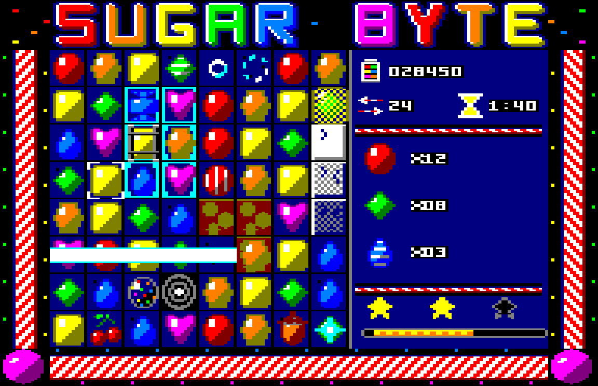

# Sugar Byte

Παιχνίδι τριάδων (match-3) τύπου Candy Crush για **Amstrad CPC**, Mode 0,
**64 KB RAM**.




*Οι δύο οθόνες όπως τις σχεδιάζουν τα γραφικά: **overscan 192×248**, με τον
τίτλο και τη μπορντούρα πάνω στο περιθώριο. Το παιχνίδι τρέχει σήμερα σε
160×200 — η μετακόμιση είναι το βήμα 16, και οι δύο δρόμοι της είναι στο
[`plan.md` §4.5](plan.md).*

## Πού είναι τι

| | |
|---|---|
| **[`plan.md`](plan.md)** | **Ξεκίνα από εδώ.** Τι είναι κάθε asset και πώς χτίζεται το παιχνίδι: χάρτης μνήμης 64 KB, δομές, αλγόριθμοι, ρουτίνες blit, σειρά υλοποίησης. |
| [`assets/`](assets/) | Τα γραφικά. **Παράγονται** — δες [`assets/README.md`](assets/README.md). |
| [`src/`](src/) | Ο κώδικας Z80 (rasm). Ξεκινάει από το [`main.asm`](src/main.asm). |
| [`tools/`](tools/) | `cpcrun.py`: headless Z80 με σενάρια και screenshots. `boot_test.py`: εκκίνηση από δισκέτα σε πλήρη εξομοιωτή 6128. |
| [`tests/`](tests/) | Τα σενάρια του `make test`. |
| [`levels/`](levels/) | Οι πίστες σε κείμενο· το `tools/levels.py` τις κάνει RLE στο build. |

## Η κατάσταση

Τα **γραφικά είναι έτοιμα**: 128 sprites σε δύο blobs — 13.696 bytes για το
παιχνίδι και 5.808 για τον τίτλο και το μενού. Ο
**κώδικας έχει φτάσει στο βήμα 15** του [`plan.md` §14](plan.md): ταμπλό, δείκτης,
ανταλλαγή και `UNSWAP`, τριάδες με σκάσιμο, βαρύτητα, γέμισμα, αλυσίδες με
πολλαπλασιαστή, πόντοι και κινήσεις στο HUD, αδιέξοδο → καινούργιο ταμπλό,
τέλος κινήσεων → SPACE για ξανά. Τα ειδικά: 4 στη σειρά → ριγέ (καθαρίζει
γραμμή ή κολόνα), Γ/Τ → περιτύλιγμα (3×3), 5 → βόμβα (ανταλλαγή μαζί της
σκάει όλο ένα χρώμα). Οι συνδυασμοί δύο ειδικών: ριγέ + ριγέ → γραμμή και
κολόνα, ριγέ + περιτύλιγμα → σταυρός πάχους 3, περιτύλιγμα + περιτύλιγμα →
5×5, βόμβα + ριγέ/περιτύλιγμα → όλο το χρώμα γίνεται ριγέ/περιτύλιγμα και
σκάει, βόμβα + βόμβα → όλο το ταμπλό. Τα κελιά: ζελέ (1–2 στρώματα, φεύγει
ένα όταν σκάει candy από πάνω), γλάσο (3 στρώματα), σοκολάτα (απλώνεται αν
δεν τη σπάσεις), γλυκόριζα· τα εμπόδια σπάνε από τριάδα δίπλα τους ή από
δέσμη ειδικού, και η βαρύτητα δεν περνάει από μέσα τους. Ώσπου να έρθουν οι
Τα υλικά (κεράσι,
φουντούκι) μπαίνουν από την κορυφή, δεν ταιριάζουν και δεν σκάνε, και όταν
φτάσουν στη βάση μαζεύονται (1.000 πόντοι)· το HUD δείχνει πόσα μένουν.
Animations: σκάσιμο σε 4 φάσεις (2 όταν σκάνε πάνω από 24 κελιά), δέσμες
των ριγέ πριν το σκάσιμο, αστέρι εκεί που γεννιέται ειδικό ή μαζεύεται υλικό,
πτώση ενός κελιού σε 2 καρέ. Μία απλή τριάδα, από την ανταλλαγή ώς το ξανά
ήσυχο ταμπλό: ~0,5 s· βόμβα + ριγέ που αδειάζει το ταμπλό: ~2,7 s.
Ήχος AY στη διακοπή των 50 Hz: μουσική σε δύο κανάλια (μελωδία, μπάσο), εφέ
στο τρίτο — επιλογή, ανταλλαγή, άκυρη, ποπ που ανεβαίνει με την αλυσίδα,
δέσμη, έκρηξη, βόμβα, υλικό, τέλος. 20 πίστες στο
[`levels/levels.txt`](levels/levels.txt) — στόχος πόντων, ζελέ, υλικών ή ζελέ
και υλικών, με όριο κινήσεων και 1–3 αστέρια· νίκη → SPACE για την επόμενη,
ήττα → SPACE για την ίδια ξανά. Η πρόοδος κρατιέται με κωδικούς πίστας: το
HUD δείχνει τον κωδικό της πίστας (και στη νίκη της επόμενης), το ESC τον
ζητάει. Επόμενο: μενού και τίτλος (βήμα 16), με γραφικά από το CPCArt.

```bash
make            # build/sugar.dsk — RUN"SUGAR
make test       # τα σενάρια του tests/, headless
make boot       # η δισκέτα σε εξομοιωτή 6128 (θέλει το ../CPCTools/cpcemu)
```

Χειρισμός: βελάκια ή joystick, SPACE / fire για επιλογή και ανταλλαγή, M για
μουσική ναι/όχι, ESC για κωδικό πίστας (←→ ψηφίο, ↑↓ τιμή, SPACE πάει, ESC
ακυρώνει).

| σετ | κελί | καρέ | bytes |
|---|---|---|---|
| `candy` | 12×24 με μάσκα | 27 | 7.776 |
| `cells` | 12×24 αδιαφανές | 10 | 1.440 |
| `overlay` | 12×24 με μάσκα | 14 | 4.032 |
| `hud` | 4×8 αδιαφανές | 28 | 448 |
| | | **79** | **13.696** |

Και σε δεύτερο blob, το `menu.bin`, για τον τίτλο και το μενού — φορτώνεται
χωριστά γιατί ο χώρος των sprites είναι γεμάτος ώς το τελευταίο byte
([`plan.md` §4.5](plan.md)):

| σετ | κελί | καρέ | bytes |
|---|---|---|---|
| `text` | 4×8 αδιαφανές | 31 | 496 |
| `icons` | 8×16 αδιαφανές | 8 | 512 |
| `title` | 192×32 αδιαφανές | 1 | 3.072 |
| `border` | 16×24 αδιαφανές | 4 | 768 |
| `menu` | 16×24 αδιαφανές | 5 | 960 |
| | | **49** | **5.808** |

## Τα γραφικά

Η πηγή τους είναι το [`CPCArt/sugarbyte`](https://github.com/vaspervnp/CPCArt).
Για να τα ξαναφέρεις:

```bash
./sync-assets.sh            # αντιγράφει ό,τι υπάρχει ήδη χτισμένο
./sync-assets.sh --regen    # τρέχει πρώτα τη γεννήτρια στο CPCArt
```
