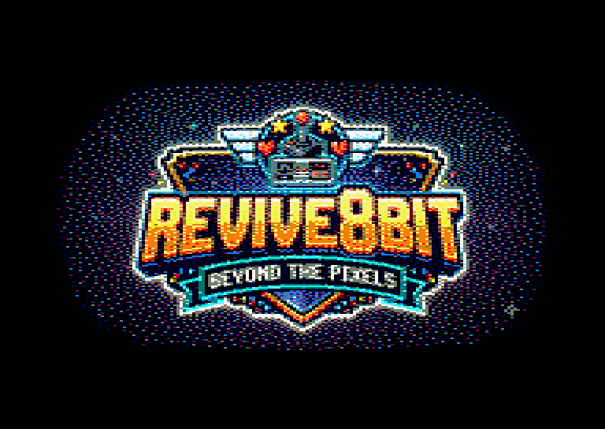
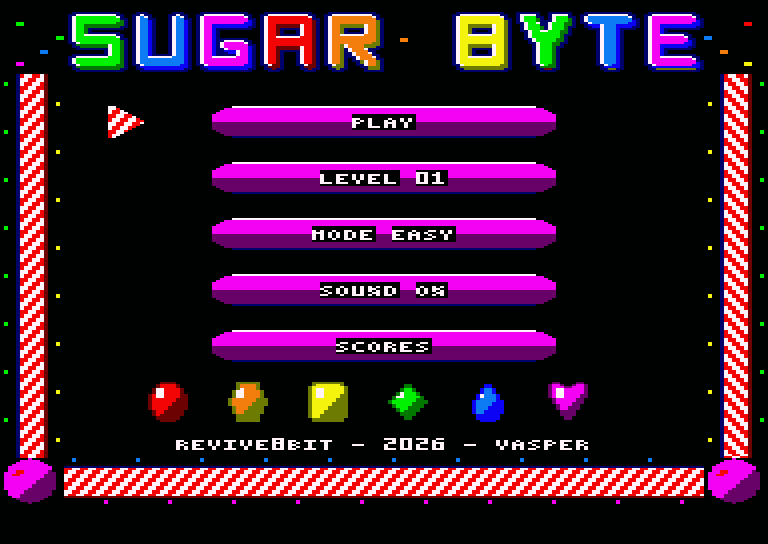
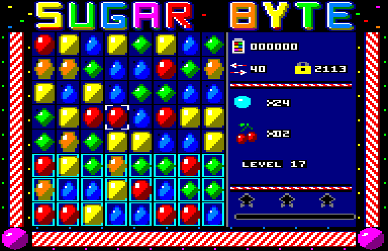
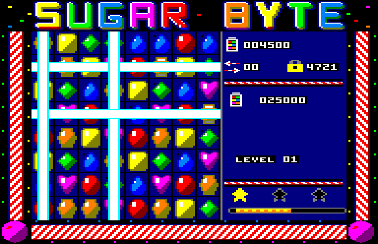
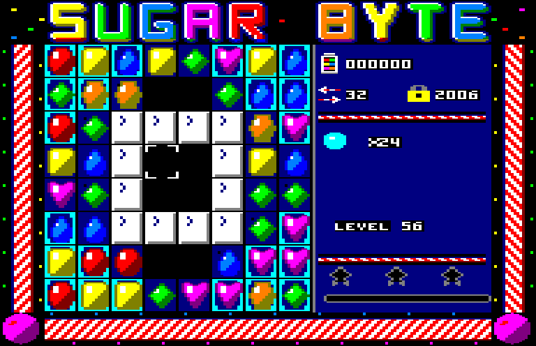

# SUGAR BYTE

**AMSTRAD CPC · ΔΙΣΚΕΤΑ 3" · ΚΑΣΕΤΑ · 64K**

*Μια παραγωγή REVIVE8BIT · VASPER · © 2026*

> English: [manual.md](manual.md)

---

## ★ ΤΟ CPC ΣΟΥ ΕΧΕΙ ΓΛΥΚΟ ΔΟΝΤΙ ★

**Εξήντα πίστες. Έξι καραμέλες. Ένα πολύ πεινασμένο Amstrad.**

Άλλαξε θέση σε δύο γλυκά, βάλε τρία ίδια στη σειρά, και το ταμπλό κάνει
**ποπ**. Βάλε τέσσερα και παίρνεις μια **ριγέ καραμέλα** που σαρώνει μια ολόκληρη
γραμμή. Φτιάξε ένα Γ και παίρνεις ένα **περιτύλιγμα** που τινάζει στον αέρα ό,τι
είναι γύρω του. Βάλε πέντε και παίρνεις τη **βόμβα χρώματος** — άλλαξέ τη με
οποιαδήποτε καραμέλα και όλες οι καραμέλες αυτού του χρώματος χάνονται μονομιάς.

Και αυτό δεν είναι το CPC που ξέρεις:

- **ΠΛΗΡΕΣ OVERSCAN.** Η εικόνα γεμίζει την οθόνη ώς την άκρη της — χωρίς
  περιθώριο, χωρίς χαμένους πόντους. 192 × 248 pixels σκέτη ζάχαρη.
- **ΜΙΛΑΕΙ.** *«Sugar Byte!» «Sweet!» «Delicious!» «Sugar Crush!»* — αληθινή
  ψηφιοποιημένη φωνή από το ίδιο το τσιπ ήχου του CPC. Χωρίς κουτί ομιλίας,
  χωρίς επεκτάσεις.
- **ΜΑΓΕΙΑ ΤΟΥ RASTER.** Δύο παλέτες στην ίδια οθόνη: ο τίτλος περνάει από όλα
  τα χρώματα του ουράνιου τόξου, ενώ το ταμπλό κρατάει και τα δεκαέξι δικά του.
- **SUGAR CRUSH!** Τελείωσε μια πίστα με κινήσεις που περισσεύουν, και κάθε
  κίνηση γίνεται μια ριγέ καραμέλα — και μετά σκάνε όλες μαζί.
- **ΤΡΕΙΣ ΔΥΣΚΟΛΙΕΣ** — EASY για να μάθεις, MEDIUM για να ιδρώσεις, HARD για να καυχιέσαι.
- **ΕΞΗΝΤΑ ΧΕΙΡΟΠΟΙΗΤΕΣ ΠΙΣΤΕΣ** — ζελέ να καθαρίσεις, γλάσο να σπάσεις, σοκολάτα
  που απλώνεται, γλυκόριζα που δεν κουνιέται, κεράσια και φουντούκια να φέρεις
  κάτω, και ταμπλό σε σχήμα διαμαντιού, κλεψύδρας και δαχτυλιδιού, όπου οι
  καραμέλες γλιστράνε διαγώνια γύρω από τα κενά.

**SUGAR BYTE.** *Το πιο γλυκό πράγμα που έπαθε ποτέ το 6128 σου.*



---

## ΦΟΡΤΩΜΑ

### Από δισκέτα

1. Άνοιξε το CPC και περίμενε το `Ready`.
2. Βάλε τη δισκέτα στο drive A, με την ετικέτα προς τα πάνω.
3. Γράψε

   ```
   RUN"SUGAR
   ```

   και πάτα `ENTER`.
4. Εμφανίζεται η οθόνη της **REVIVE8BIT**. Πάτα `SPACE` για να συνεχίσεις αμέσως,
   ή περίμενε δέκα δευτερόλεπτα και το παιχνίδι θα φορτώσει μόνο του.
5. Θα ακούσεις *«Sugar Byte!»* και θα εμφανιστεί το μενού.

**Μην** πατήσεις `ESC` ή reset όσο ανάβει το λαμπάκι του drive.

### Από κασέτα

1. Σε 6128 ή 664, γράψε πρώτα `|TAPE` και πάτα `ENTER`. (Το `|` είναι
   `SHIFT` + `@`.) Το 464 είναι ήδη έτοιμο για κασέτα.
2. Γύρνα την κασέτα στην αρχή.
3. Κράτα πατημένο το `CTRL` και πάτα το μικρό `ENTER`, μετά πάτα `PLAY` στο
   κασετόφωνο και ένα οποιοδήποτε πλήκτρο στον υπολογιστή.
4. Το φόρτωμα κρατάει περίπου τρισήμισι λεπτά. Μετά θα ακούσεις
   *«Sugar Byte!»* και θα εμφανιστεί το μενού. (Η κασέτα δεν έχει την οθόνη της
   REVIVE8BIT.)

*Το Sugar Byte παίζει σε κάθε CPC με 64K: 464, 664 ή 6128. Η δισκέτα θέλει drive
δισκέτας. Δοκιμάστηκε στο 6128.*

---

## ΤΟ ΜΕΝΟΥ



Κουνάς τον ριγέ δείκτη με τα **βελάκια** ή το **joystick**, και διαλέγεις με
**SPACE** ή **FIRE**.

| | |
|---|---|
| **PLAY** | Ξεκινάει την πίστα που γράφει από κάτω. |
| **LEVEL NN** | Γράφεις έναν **κωδικό πίστας** για να πας σε πίστα που έχεις ήδη φτάσει (δες *Κωδικοί πίστας*). |
| **MODE EASY / MEDIUM / HARD** | Η δυσκολία: το **SPACE** περνάει από τις τρεις (δες *Δυσκολία*). |
| **SOUND ON / OFF** | Μουσική ναι ή όχι. |
| **SCORES** | Οι καλύτεροί σου πόντοι και τα αστέρια σε κάθε πίστα, στη δυσκολία που έχεις διαλέξει. Είκοσι πίστες τη σελίδα: **←** και **→** γυρίζουν σελίδα, **SPACE** ή **ESC** πίσω. |

---

## ΠΩΣ ΠΑΙΖΕΤΑΙ



Το ταμπλό είναι 8 × 8. Κουνάς τον δείκτη με τα **βελάκια** ή το **joystick** και
πατάς **SPACE** / **FIRE** για να πιάσεις μια καραμέλα — φωτίζεται κυανή. Μετά
πιάνεις μια καραμέλα **ακριβώς δίπλα της** (αριστερά, δεξιά, πάνω ή κάτω), και
οι δύο αλλάζουν θέση.

- Αν η αλλαγή φτιάχνει μια σειρά από **τρεις ή περισσότερες ίδιες**, οριζόντια
  ή κάθετα, σκάνε. Οι καραμέλες από πάνω πέφτουν να γεμίσουν το κενό, και
  καινούργιες μπαίνουν από την κορυφή. Αν αυτές που πέφτουν φτιάξουν νέες
  σειρές, σκάνε κι εκείνες — αυτό είναι **αλυσίδα**, και κάθε κρίκος της
  πολλαπλασιάζει τους πόντους σου.
- Αν η αλλαγή δεν φτιάχνει σειρά, οι καραμέλες γυρίζουν πίσω και δεν σου
  κοστίζει κίνηση.
- Πιάσε την ίδια καραμέλα ξανά για να την αφήσεις. Πιάσε μια πιο μακρινή και
  η επιλογή πηγαίνει σε εκείνη.

Κάθε αλλαγή που πιάνει **τρώει μία κίνηση**. Όσες μένουν φαίνονται δίπλα στα
δύο βελάκια, στο πάνελ δεξιά.

**Κόλλησες;** Περίμενε πέντε δευτερόλεπτα χωρίς να αγγίξεις τίποτα, και δύο
καραμέλες θα αρχίσουν να γέρνουν η μία προς την άλλη — αυτή είναι μια κίνηση
που μπορείς να κάνεις. Αν δεν έχει μείνει καμία κίνηση σε όλο το ταμπλό,
ανακατεύεται δωρεάν.

| Πλήκτρο | |
|---|---|
| Βελάκια / joystick | Κουνάνε τον δείκτη |
| SPACE / FIRE | Πιάνει, αλλάζει θέση |
| M | Μουσική ναι / όχι |
| ESC | Πίσω στο μενού |

---

## ΤΟ ΠΑΝΕΛ

Από πάνω προς τα κάτω:

- **Το βάζο** — οι πόντοι σου.
- **Τα βελάκια** — οι κινήσεις που μένουν. **Το λουκέτο** — ο κωδικός της πίστας.
- **Ο στόχος** — τι πρέπει να κάνεις για να κερδίσεις: πόντους να φτάσεις,
  κελιά με ζελέ να καθαρίσεις, υλικά να φέρεις κάτω.
- **LEVEL NN** — η πίστα που παίζεις.
- **Τρία αστέρια** και ο **σωλήνας προόδου** — ανάβουν καθώς οι πόντοι σου
  περνάνε το όριο κάθε αστεριού.

---

## ΟΙ ΣΤΟΧΟΙ

Κάθε πίστα έχει μετρημένες κινήσεις και έναν στόχο:

- **ΠΟΝΤΟΙ** — φτάσε τους πόντους του στόχου.
- **ΖΕΛΕ** — καθάρισε όλα τα κελιά με ζελέ. Το ζελέ κάθεται **κάτω** από τις
  καραμέλες· φεύγει όταν σκάσει καραμέλα από πάνω του. Το διπλό θέλει δύο φορές.
- **ΥΛΙΚΑ** — φέρε τα κεράσια και τα φουντούκια κάτω. Δεν ταιριάζουν και δεν
  σκάνε: καθάρισε τις καραμέλες από κάτω τους και πέφτουν. Φεύγουν από το
  ταμπλό όταν φτάσουν στην κάτω γραμμή — **ή όταν κάθονται ακριβώς πάνω από
  ένα κενό**.
- **ΖΕΛΕ + ΥΛΙΚΑ** — και τα δύο μαζί.

Μόλις φτάσεις τον στόχο κερδίζεις, όσες κινήσεις κι αν σου μένουν. Και μετά
έρχεται το **Sugar Crush**: κάθε κίνηση που δεν χρειάστηκες κάνει μια τυχαία
καραμέλα ριγέ, και μετά σκάνε όλες μαζί, για πόντους.



Όταν κερδίσεις, τα αστέρια σου εμφανίζονται στο ταμπλό: **ένα** για τη νίκη,
**δύο** και **τρία** για περισσότερους πόντους. Πάτα **SPACE** για την επόμενη
πίστα — ο κωδικός της φαίνεται στο πάνελ.

Αν τελειώσουν πρώτα οι κινήσεις, το περίγραμμα αναβοσβήνει. Πάτα **SPACE** για
την ίδια πίστα ξανά, ή **ESC** για το μενού.

---

## ΔΥΣΚΟΛΙΑ

Κάθε πίστα παίζεται με τρεις τρόπους. Διάλεξε με το **MODE** στο μενού πριν
πατήσεις **PLAY**:

| | |
|---|---|
| **EASY** | Όλες οι κινήσεις που σχεδιάστηκε να έχει η πίστα. Ξεκίνα από εδώ. |
| **MEDIUM** | Περίπου τα τέσσερα πέμπτα των κινήσεων. |
| **HARD** | Περίπου τα δύο τρίτα των κινήσεων — κάθε αλλαγή πρέπει να μετράει. |

Το ταμπλό και ο στόχος μένουν ίδια, άρα το ίδιο σχέδιο δουλεύει — απλώς έχεις
λιγότερο περιθώριο για λάθη. Λιγότερες κινήσεις σημαίνουν και λιγότερους
πόντους, άρα και τα αστέρια είναι πιο δύσκολα, και περισσεύουν λιγότερες
κινήσεις για το Sugar Crush. Οι καλύτεροι πόντοι και τα αστέρια κρατιούνται
χωριστά για κάθε δυσκολία, και ένας κωδικός πίστας ισχύει και στις τρεις.

---

## ΟΙ ΕΙΔΙΚΕΣ ΚΑΡΑΜΕΛΕΣ

| Βάλε | Παίρνεις | Τι κάνει |
|---|---|---|
| 4 στη σειρά | **Ριγέ καραμέλα** | Όταν σκάσει, καθαρίζει με μια δέσμη όλη τη γραμμή της — ή όλη την κολόνα της. |
| Σχήμα Γ ή Τ | **Περιτύλιγμα** | Όταν σκάσει, τινάζει το τετράγωνο 3 × 3 γύρω του. |
| 5 στη σειρά | **Βόμβα χρώματος** | Άλλαξέ τη με μια καραμέλα: σκάνε όλες οι καραμέλες αυτού του χρώματος. |

Η ειδική καραμέλα εμφανίζεται εκεί που έκανες την κίνηση, και σκάει όταν γίνει
μέρος σειράς — ή όταν τη χτυπήσει άλλη ειδική.

**Άλλαξε θέση σε δύο ειδικές μεταξύ τους** για κάτι πολύ μεγαλύτερο:

| Αλλαγή | Αποτέλεσμα |
|---|---|
| Ριγέ + ριγέ | Όλη μια γραμμή **και** όλη μια κολόνα. |
| Ριγέ + περιτύλιγμα | Ένας σταυρός πλάτους τριών καραμελών. |
| Περιτύλιγμα + περιτύλιγμα | Έκρηξη 5 × 5. |
| Βόμβα + ριγέ | Όλες οι καραμέλες του χρώματος γίνονται ριγέ — και σκάνε όλες. |
| Βόμβα + περιτύλιγμα | Όλες οι καραμέλες του χρώματος γίνονται περιτυλίγματα — και σκάνε όλες. |
| Βόμβα + βόμβα | Όλο το ταμπλό. |

---

## ΤΙ ΕΧΕΙ ΤΟ ΤΑΜΠΛΟ

| | |
|---|---|
| **Ζελέ** | Κάτω από τις καραμέλες. Σκάσε μια καραμέλα από πάνω για να φύγει ένα στρώμα. |
| **Γλάσο** (1–3 στρώματα) | Εμπόδιο. Κάθε σειρά που σκάει δίπλα του, ή η δέσμη μιας ειδικής, σπάει ένα στρώμα. |
| **Σοκολάτα** | Εμπόδιο που **απλώνεται**: αν τελειώσεις μια κίνηση χωρίς να σπάσεις καμία σοκολάτα, μεγαλώνει πάνω σε μια διπλανή καραμέλα. |
| **Γλυκόριζα** | Εμπόδιο που σπάει όπως το γλάσο. |
| **Κενά** | Τρύπες στο ταμπλό. Εκεί δεν πάει ποτέ τίποτα. |

Οι καραμέλες δεν πέφτουν **μέσα από** ένα εμπόδιο ή ένα κενό. Αντί γι' αυτό
**γλιστράνε διαγώνια** γύρω του: ένα άδειο κελί που δεν μπορεί να γεμίσει από
πάνω παίρνει την καραμέλα από το κελί πάνω-αριστερά ή πάνω-δεξιά. Έτσι ακόμα
και τα πιο παράξενα ταμπλό ξαναγεμίζουν — και τα εμπόδια κρατάνε το σχήμα τους
ώσπου να τα σπάσεις.



---

## ΟΙ ΠΟΝΤΟΙ

| | Πόντοι |
|---|---|
| Σειρά των 3 | 60 |
| Σειρά των 4 | 120 |
| Σειρά των 5 | 200 |
| Κάθε καραμέλα που χτυπάει ειδική | 60 |
| Κάθε στρώμα ζελέ | 100 |
| Κάθε υλικό που κατεβαίνει | 1.000 |

**Όλα πολλαπλασιάζονται με την αλυσίδα:** το πρώτο σκάσιμο μετράει μία φορά,
όσα φέρνουν οι καραμέλες που πέφτουν μετράνε διπλά, τα επόμενα τριπλά, και
πάει λέγοντας. Μια μακριά αλυσίδα παίρνει κι ένα *«Sweet!»* — και μια πολύ
μακριά, *«Delicious!»*

---

## ΚΩΔΙΚΟΙ ΠΙΣΤΑΣ

Κάθε πίστα έχει τον δικό της τετραψήφιο κωδικό. Φαίνεται δίπλα στο **λουκέτο**
στο πάνελ όσο παίζεις, και όταν κερδίσεις μια πίστα το πάνελ δείχνει τον κωδικό
της **επόμενης**. Γράψ' τους κάπου.

Για να χρησιμοποιήσεις έναν κωδικό, διάλεξε **LEVEL NN** στο μενού και πάτα
**SPACE**. Το πιάτο γίνεται `CODE 0000`:

- **← →** διαλέγουν ψηφίο (αναβοσβήνει),
- **↑ ↓** το αλλάζουν,
- **SPACE** το δέχεται, **ESC** ακυρώνει.

Ένας σωστός κωδικός σε πάει κατευθείαν σε εκείνη την πίστα. Ένας λάθος κάνει
έναν ξινό ήχο και σε αφήνει να ξαναδοκιμάσεις.

Ο πρώτος είναι δώρο: η πίστα 1 είναι **4721**.

*Οι καλύτεροι πόντοι και τα αστέρια κρατιούνται όσο ο υπολογιστής μένει ανοιχτός.*

---

## ΣΥΜΒΟΥΛΕΣ ΑΠΟ ΤΗΝ ΚΟΥΖΙΝΑ

- **Παίζε χαμηλά.** Οι κινήσεις κοντά στη βάση ανακατεύουν όλο το ταμπλό από
  πάνω τους και φέρνουν περισσότερες αλυσίδες από τις κινήσεις στην κορυφή.
- **Φτιάξε ειδικές πριν τις χρειαστείς.** Μια τετράδα στο σωστό σημείο σού
  γλιτώνει τρεις κινήσεις αργότερα.
- **Φέρε τα υλικά κάτω από τη δική τους κολόνα.** Κουνιούνται μόνο όταν
  αδειάσουν τα κελιά ακριβώς από κάτω τους.
- **Μην αφήνεις ποτέ τη σοκολάτα ήσυχη.** Σπάσε τουλάχιστον ένα κομμάτι σε κάθε
  κίνηση, αλλιώς θα σε κατακλύσει.
- **Κράτα κινήσεις για το τέλος.** Κάθε κίνηση που δεν χρησιμοποιείς γίνεται
  ριγέ καραμέλα στο Sugar Crush, και εκεί είναι τα τρία αστέρια.

---

## ΤΙΤΛΟΙ

**Σχεδιασμός, κώδικας, γραφικά:** VASPER
**Μια παραγωγή REVIVE8BIT · 2026**

Γραμμένο σε assembly Z80 με τον rasm. Γραφικά ζωγραφισμένα στο CPCArt. Η φωνή
φτιάχτηκε σε PC και παίζει ως δείγματα 4-bit από τα τρία κανάλια του τσιπ ήχου
AY του CPC ταυτόχρονα.

---

*Εξήντα πίστες. Δεκαέξι χρώματα. Ένα γλυκό δόντι.*

## **SUGAR BYTE — Σκάσ' το. Άλλαξέ το. Λιώσ' το.**

*Σε δισκέτα 3" και κασέτα για το Amstrad CPC.*
