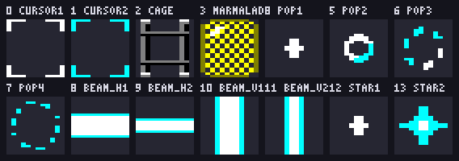
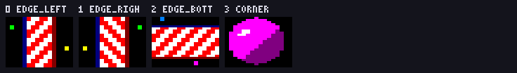

# Sugar Byte — σχέδιο υλοποίησης

Παιχνίδι τριάδων (match-3) τύπου Candy Crush για **Amstrad CPC με 64 KB RAM**,
σε **Mode 0**. Τα γραφικά είναι έτοιμα και βρίσκονται στο `assets/`· αυτό το
κείμενο λέει **τι είναι το καθένα** και **πώς χτίζεται το παιχνίδι γύρω τους**.


---

## 1. Τι είναι το Sugar Byte

Ταμπλό **8×8**. Ο παίκτης ανταλλάσσει δύο γειτονικά candies· αν η ανταλλαγή
φτιάξει τριάδα ή μεγαλύτερη σειρά ίδιου χρώματος, αυτά σκάνε, τα από πάνω
πέφτουν, καινούργια μπαίνουν από την κορυφή, και όσες αλυσιδωτές τριάδες
προκύψουν μετράνε με πολλαπλασιαστή. Τέσσερα στη σειρά φτιάχνουν ριγέ, πέντε
φτιάχνουν βόμβα χρώματος, σχήμα Γ ή Τ φτιάχνει περιτύλιγμα. Κάθε πίστα έχει
στόχο (πόντοι, ζελέ, υλικά) και όριο κινήσεων ή χρόνου.

**Γιατί ταιριάζει στον CPC:** δεν υπάρχει scrolling, δεν υπάρχουν δεκάδες
sprites που κινούνται ταυτόχρονα, και όλη η δουλειά της οθόνης είναι
«ξαναζωγράφισε τα κελιά που άλλαξαν». Ο Z80 στα 4 MHz το βγάζει άνετα.

---

## 2. Η μηχανή

| | |
|---|---|
| Μηχάνημα | Amstrad CPC 464 / 664 / 6128, **64 KB** (χωρίς banking) |
| Οθόνη | Mode 0 — 160×200 pixels, 16 pens, **2 pixels το byte** |
| Αναλογία pixel | **2:1** — ένα pixel είναι διπλάσια φαρδύ από ψηλό |
| Μνήμη οθόνης | `#C000`–`#FFFF`, 16.384 bytes |
| Ήχος | AY-3-8912, 3 κανάλια τετραγωνικού + θόρυβος |

### Διευθύνσεις οθόνης

Η μνήμη οθόνης του CPC **δεν είναι γραμμική**:

```
διεύθυνση(γραμμή y, byte c) = #C000 + (y & 7) * #800 + (y >> 3) * #50 + c
```

Η επόμενη γραμμή είναι `+#800`, και κάθε 8 γραμμές `-#37B0`. Η κλασική ρουτίνα:

```z80
; HL = διεύθυνση οθόνης -> επόμενη γραμμή
next_line:
    ld   a,h
    add  a,8
    ld   h,a
    ret  nc            ; μείναμε στο ίδιο μπλοκ των 8 γραμμών
    ld   a,l
    add  a,#50
    ld   l,a
    ld   a,h
    adc  a,#C0
    ld   h,a
    ret
```

Το παιχνίδι όμως **δεν τη χρησιμοποιεί στον βρόχο**: κρατάει πίνακα 200
διευθύνσεων (400 bytes) και διαβάζει κατευθείαν `line_addr[y]`. Είναι ο
φθηνότερος πίνακας που θα φτιάξεις ποτέ.

### Η παλέτα

Δεκαέξι pens από τα 27 του firmware (`assets/palette.gpl`, και αναλυτικά στο
`assets/manifest.json`). Τα **τέσσερα πρώτα είναι καρφωμένα**, τα **δώδεκα
υπόλοιπα είναι τα έξι χρώματα των candies** σε ζεύγη βάση + σκιά.


| pen | FW | χρώμα | ρόλος |
|---|---|---|---|
| 0 | 0 | `#000000` | φόντο ταμπλό **και** μάσκα των sprites |
| 1 | 26 | `#FFFFFF` | ανταύγεια, ρίγες, γράμματα |
| 2 | 13 | `#808080` | γκρι: πλέγμα, γλάσο, χρώμια |
| 3 | 1 | `#000080` | περίγραμμα candy, σκιά, ταμπλό HUD |
| 4 | 20 | `#00FFFF` | ζελέ, εφέ, τόνος UI |
| 5 / 6 | 6 / 3 | `#FF0000` / `#800000` | **κόκκινο** βάση / σκιά |
| 7 / 8 | 15 / 12 | `#FF8000` / `#808000` | **πορτοκαλί** βάση / σκιά |
| 9 / 8 | 24 / 12 | `#FFFF00` / `#808000` | **κίτρινο** βάση / σκιά |
| 10 / 11 | 18 / 9 | `#00FF00` / `#008000` | **πράσινο** βάση / σκιά |
| 12 / 13 | 11 / 2 | `#0080FF` / `#0000FF` | **μπλε** βάση / σκιά |
| 14 / 15 | 8 / 4 | `#FF00FF` / `#800080` | **μωβ** βάση / σκιά |

Στήσιμο με το firmware: `SCR SET INK` (`#BC32`) για κάθε pen, ή γράψιμο
κατευθείαν στον Gate Array (`#7F00`) αν έχεις πάρει τη μηχανή.

> **Προσοχή:** το **πορτοκαλί και το κίτρινο μοιράζονται τη σκιά τους** (pen 8).
> Δεν περίσσευε δέκατο έκτο pen. Άρα ο τύπος `5 + 2 × χρώμα` **δεν ισχύει** —
> κράτα πίνακα `candy_pens` με 6 ζεύγη (12 bytes).

---

## 3. Τι είναι κάθε asset

Όλα είναι στο `assets/`. Τα **PNG και τα `.aseprite` είναι για να τα βλέπεις
και να τα πειράζεις**· το παιχνίδι φορτώνει **μόνο** το `sprites.bin`.

| Αρχείο | Τι είναι |
|---|---|
| `sprites.bin` | 13.696 bytes — τα τέσσερα σετ **του παιχνιδιού** σε αυθεντικά bytes Mode 0. Αυτό κάνεις `incbin` στο `#4000`. |
| `menu.bin` | 5.808 bytes — τα πέντε σετ **του τίτλου και του μενού**. Φορτώνεται χωριστά· δες §4.5. |
| `menu.asm` | οι σταθερές του δεύτερου blob (`TEXT_*`, `ICONS_*`, `TITLE_*`, `BORDER_*`, `MENU_*`) |
| `sprites.asm` | Οι σταθερές (`CANDY_SZ`, `CANDY_PLAIN`, …) και τα ίδια δεδομένα ως `db`, αν προτιμάς assemble αντί για `incbin`. |
| `sprites_map.txt` | Πού κάθεται **κάθε καρέ** μέσα στα δύο blobs, με όνομα, tag και offset. Ο κατάλογος που κοιτάς όταν γράφεις κώδικα. |
| `palette.gpl` | Η παλέτα για GIMP/Aseprite, με τα firmware numbers σε σχόλιο. |
| `manifest.json` | Σύνοψη για εργαλεία: παλέτα, σετ, μεγέθη, διάταξη ταμπλό, μνήμη. |
| `sheets/*_sheet.png` | Το κάθε σετ ως ένα PNG 16 χρωμάτων, 7 καρέ τη σειρά, αυθεντικά pixels. |
| `sheets/*_sheet.json` | Όνομα, tag και θέση κάθε καρέ μέσα στο φύλλο. |
| `aseprite/*.aseprite` | Οι πηγές για πείραγμα με το χέρι — pixel ratio 2:1, tags ανά ομάδα, όνομα καρέ στο user data του cel. |
| `preview/preview_*.png` | Κατάλογοι με δείκτες, σε **αναλογία 2:1** (έτσι φαίνονται στην τηλεόραση). |
| `preview/mockup_screen.png` | Μία πλήρης οθόνη 160×200 σε αυθεντικά pixels. |
| `preview/mockup_screen_2x1.png` | Η ίδια οθόνη με σωστή αναλογία, ×3. |

### 3.1 Τα μεγέθη

Ένα **κελί ταμπλό** είναι **12 pixels φάρδος × 24 γραμμές** — τετράγωνο στην
οθόνη (24×24 «μονάδες»), **6 bytes τη γραμμή**. Το ταμπλό 8×8 πιάνει 96×192
pixels και κάθεται στο `x=0, y=4`· μένουν **64 pixels δεξιά για το HUD**
(`x=96`–`159`).

Ένα **κελί HUD** είναι **4×8** (8×8 μονάδες), **2 bytes τη γραμμή**.

### 3.2 `candy_gfx` — 27 candies, 12×24, **με μάσκα**, 288 bytes/καρέ


Κάθε χρώμα έχει **δική του σιλουέτα**, όχι μόνο δικό του χρώμα. Αυτό δεν είναι
διακόσμηση: σε Mode 0 δύο διπλανά pens μπερδεύονται σε μικρή οθόνη, σε
ασπρόμαυρη τηλεόραση ή σε παίκτη με αχρωματοψία, και το σχήμα είναι το μόνο
που κρατάει.

| κωδικός | χρώμα | σχήμα |
|---|---|---|
| 0 | κόκκινο | μπαλάκι |
| 1 | πορτοκαλί | εξάγωνο |
| 2 | κίτρινο | τετράγωνο |
| 3 | πράσινο | ρόμβος |
| 4 | μπλε | δάκρυ |
| 5 | μωβ | καρδιά |

| tag | καρέ | περιεχόμενο |
|---|---|---|
| `CANDY_PLAIN` | 0–5 | το κανονικό candy, ένα ανά χρώμα |
| `CANDY_STRIPED_H` | 6–11 | ριγέ οριζόντια — καθαρίζει **γραμμή** |
| `CANDY_STRIPED_V` | 12–17 | ριγέ κάθετα — καθαρίζει **κολόνα** |
| `CANDY_WRAPPED` | 18–23 | περιτύλιγμα — σκάει **3×3** |
| `CANDY_BOMB` | 24 | βόμβα χρώματος (ένα καρέ, άχρωμη) |
| `CANDY_INGREDIENT` | 25–26 | κεράσι, φουντούκι |

Σε κάθε tag η σειρά των χρωμάτων είναι **πάντα η ίδια**, άρα:

```
καρέ = tag + χρώμα          ; εκτός από βόμβα και υλικά
διεύθυνση = candy_gfx + καρέ * CANDY_SZ
```

Το **περιτύλιγμα είναι ένα σχήμα για όλα τα χρώματα** (όπως στο Candy Crush) —
αλλάζει μόνο το χρώμα του. Τα **ριγέ δεν έχουν ανταύγεια**: η λευκή βούλα
κολλούσε στις ρίγες και γινόταν μπάλωμα.

### 3.3 `cells_gfx` — 10 κελιά ταμπλό, 12×24, **αδιαφανή**, 144 bytes/καρέ


| καρέ | όνομα | τι είναι |
|---|---|---|
| 0 | `plain` | κανονικό κελί |
| 1 | `plain_alt` | το άλλο χρώμα της σκακιέρας (τρεις βούλες, επίτηδες διακριτικό) |
| 2 | `hole` | έξω από το ταμπλό — σκέτο μαύρο |
| 3 | `jelly1` | ζελέ, ένα στρώμα |
| 4 | `jelly2` | ζελέ, δύο στρώματα |
| 5 | `icing3` | γλάσο, 3 στρώματα (άθικτο) |
| 6 | `icing2` | γλάσο, 2 στρώματα |
| 7 | `icing1` | γλάσο, 1 στρώμα (ραγισμένο) |
| 8 | `chocolate` | σοκολάτα — εξαπλώνεται αν δεν τη σπάσεις |
| 9 | `licorice` | ρόδα γλυκόριζας — φράζει το κελί |

Το **ζελέ σημαδεύεται στο περίγραμμα** του κελιού, όχι στο γέμισμα: το γέμισμα
το σκεπάζει το candy και δεν θα φαινόταν ποτέ. Το **γλάσο μετριέται και από τη
φωτεινότητα και από τις ρωγμές**.

Το πλέγμα μπαίνει στη **δεξιά κολόνα και στην κάτω γραμμή** κάθε κελιού, ώστε
δύο γειτονικά κελιά να δίνουν μία γραμμή και όχι δύο. Άρα το ταμπλό χρειάζεται
δική του γραμμή αριστερά και πάνω, αν τη θες.

### 3.4 `overlay_gfx` — 14 επικαλύψεις, 12×24, **με μάσκα**, 288 bytes/καρέ



Ζωγραφίζονται **πάνω** από ένα candy.

| tag | καρέ | περιεχόμενο |
|---|---|---|
| `OVERLAY_CURSOR` | 0–1 | ο δείκτης — δύο καρέ για να αναβοσβήνει (άσπρο / κυανό) |
| `OVERLAY_BLOCKER` | 2–3 | `cage` κλουβί γλυκόριζας, `marmalade` κέλυφος |
| `OVERLAY_POP` | 4–7 | η έκρηξη, 4 καρέ: λάμψη → στεφάνι → σπάσιμο → σκόνη |
| `OVERLAY_BEAM_H` | 8–9 | η δέσμη του ριγέ-οριζόντια, 2 πάχη |
| `OVERLAY_BEAM_V` | 10–11 | η δέσμη του ριγέ-κάθετα, 2 πάχη |
| `OVERLAY_STAR` | 12–13 | αστέρι πόντων, μικρό και μεγάλο |

Η **μαρμελάδα είναι σκακιέρα 1 pixel × 2 γραμμές**: το Mode 0 δεν έχει
«μισό-διάφανο», και ο dither 1×2 είναι ο μόνος που δεν τρεμοπαίζει στην
τηλεόραση (1×1 θα έκανε interlace flicker).

### 3.5 `hud_gfx` — 28 κελιά HUD, 4×8, **αδιαφανή**, 16 bytes/καρέ


| tag | καρέ | περιεχόμενο |
|---|---|---|
| `HUD_DIGITS` | 0–9 | τα ψηφία `0`–`9`· **καρέ = ψηφίο** |
| `HUD_SYMBOLS` | 10–13 | `:` `/` `×` `+` |
| `HUD_ICONS` | 14–18 | κινήσεις, πόντοι, στόχος, χρόνος, κλειδωμένο |
| `HUD_PANEL` | 19–27 | τα 9 κομμάτια του πλαισίου (tl, tc, tr, ml, mc, mr, bl, bc, br) |

Το κελί 4×8 είναι **ίδιο με τη γραμματοσειρά 4×8 του `CPCArt/planetbase`** —
αν θες γράμματα, μπαίνουν δίπλα σε αυτά τα ψηφία χωρίς καμία μετατροπή.

Οι **στόχοι της πίστας δείχνονται με τα ίδια τα candies 12×24**· δεν
χρειάζονται δικά τους εικονίδια.

### 3.6 Τα σετ του `menu.bin`

Αυτά **δεν** είναι στο `sprites.bin` και δεν φορτώνονται όσο παίζεις. Ζωγραφίζονται
μία φορά και μετά ο χώρος τους ξαναχρησιμεύει — δες §4.5.


| σετ | κελί | καρέ | bytes | περιεχόμενο |
|---|---|---|---|---|
| `text_gfx` | 4×8 αδιαφανές | 31 | 496 | `TEXT_LETTERS` τα κεφαλαία `A`–`Z` (καρέ = γράμμα − `A`), `TEXT_RULE` χάρακας από ζαχαρωτό, `TEXT_BAR` σωλήνας προόδου (αριστερό καπάκι, άδειο, γεμάτο, δεξί) |
| `icons_gfx` | 8×16 αδιαφανές | 8 | 512 | βάζο, βέλη ανταλλαγής, κλεψύδρα, γλειφιτζούρι, ζελέ, δύο αστέρια, λουκέτο |
| `title_gfx` | 192×32 αδιαφανές | 1 | 3.072 | το λογότυπο, όσο ακριβώς και η πάνω μπορντούρα |
| `border_gfx` | 16×24 αδιαφανές | 4 | 768 | `BORDER_EDGE` αριστερό/δεξί/κάτω κορδόνι, `BORDER_CORNER` ζαχαρωτό γωνίας |
| `menu_gfx` | 16×24 αδιαφανές | 5 | 960 | `MENU_PLATE` πιάτο σε τρία κομμάτια, `MENU_POINTER` δείκτης σε δύο φάσεις |

 

Τα κεφαλαία είναι **οι ίδιες μορφές με τη γραμματοσειρά 4px του
`CPCArt/planetbase`** — στις τρεις στήλες το `N`, το `M` και το `W` είναι
λυμένα εκεί και δοκιμασμένα. Στοιχίζονται στη **βάση** των ψηφίων του
`hud_gfx`, γι' αυτό ξεκινούν μία γραμμή πιο κάτω.

Τα εικονίδια είναι 8×16 και όχι 4×8 επειδή σε τέσσερις στήλες ένα γλειφιτζούρι
δεν διαβάζεται με τίποτα. Τα μικρά 4×8 του `HUD_ICONS` μένουν όπως είναι.

Οι ρίγες της μπορντούρας είναι φτιαγμένες ώστε **τα πλακάκια να ενώνονται χωρίς
ραφή**: το πλαϊνό επαναλαμβάνεται κάθε 24 γραμμές και το κάτω κάθε 16 pixels,
και το πλάτος ρίγας (2) είναι η μόνη τιμή που βγάζει ζυγή φάση και στα δύο.

---

## 4. Η μορφή στη μνήμη και οι ρουτίνες σχεδίασης

Τα δεδομένα είναι **γραμμικά, γραμμή-γραμμή** — **όχι** στη διάταξη της μνήμης
οθόνης. Το blit προχωράει μία γραμμή οθόνης τη φορά.

### 4.1 Αδιαφανή (κελιά ταμπλό, HUD)

Σκέτα data bytes. `CELLS_W = 6` σημαίνει 6 bytes τη γραμμή, και η γραμμή στη
μνήμη **είναι** 6 bytes.

```z80
; HL = πηγή, DE = οθόνη. 6 bytes x 24 γραμμές.
blit_cell:
    ld   c,24
.row:
    ld   a,e
    ld   (.restore+1),a
    ld   a,d
    ld   (.restore+3),a
    ldi : ldi : ldi : ldi : ldi : ldi      ; BC πρέπει να μένει != 0
.restore:
    ld   e,0
    ld   d,0
    call next_line_de
    dec  c
    jr   nz,.row
    ret
```

Στην πράξη κράτα τη διεύθυνση της γραμμής σε ένα `push de` / `pop de` ή σε
ζεύγος shadow· το παραπάνω είναι για να φανεί ότι **το `LDI` χαλάει το `DE`**.

### 4.2 Με μάσκα (candies, επικαλύψεις)

Πλεγμένα `mask, data, mask, data…` ανά γραμμή. **Η μάσκα έχει `#F` σε κάθε
nibble όπου το pixel είναι διάφανο** και `0` αλλού, ώστε `AND mask` μετά
`OR data`.

> **ΠΡΟΣΟΧΗ — το λάθος που θα κάνεις:** οι σταθερές `_W` δίνουν bytes
> **ΔΕΔΟΜΕΝΩΝ** ανά γραμμή. Σε sprite με μάσκα η γραμμή πιάνει **2×** αυτό.
> `CANDY_W = 6` αλλά η γραμμή είναι **12 bytes** στη μνήμη, και
> `CANDY_SZ = 288` όχι 144.

```z80
; HL = sprite (mask,data πλεγμένα), DE = οθόνη. 6 bytes δεδομένων x 24 γραμμές.
blit_candy:
    ld   c,24
.row:
    push de
    ; ξετυλιγμένο x6 — ο βρόχος με DJNZ κοστίζει 3 µs ανά byte τζάμπα
    rept 6
      ld  a,(de)
      and (hl)      ; μάσκα: μηδενίζει ό,τι θα σκεπάσει το sprite
      inc hl
      or  (hl)      ; δεδομένα
      inc hl
      ld  (de),a
      inc e         ; βλ. σημείωση
    endr
    pop  de
    call next_line_de
    dec  c
    jr   nz,.row
    ret
```

**Το `inc e` αντί για `inc de`** γλιτώνει 1 µs ανά byte (144 µs ανά candy) αλλά
ισχύει μόνο αν η γραμμή των 6 bytes **δεν περνάει όριο σελίδας 256**. Με το
ταμπλό στο `x=0` και κελί 6 bytes, οι κολόνες ξεκινάνε στα byte offsets
0, 6, 12, …, 42 μέσα σε γραμμή 80 bytes — **έλεγξέ το ανά κολόνα μία φορά στην
αρχή** και κράτα σημαία, ή απλώς χρησιμοποίησε `inc de` και μην το σκέφτεσαι.

### 4.3 Πόσο κοστίζει

Στον CPC ο Gate Array βάζει waits ώστε **κάθε εντολή να στρογγυλεύει σε
ακέραια µs** (1 µs = 4 T). Ένα καρέ στα 50 Hz είναι **20.000 µs**.

| | |
|---|---|
| ένα byte με μάσκα | 7 εντολές × 2 µs = **14 µs** (13 µs με `inc e`) |
| μία γραμμή candy | 6 × 14 = 84 µs |
| **ένα candy 12×24** | 24 × 84 + overhead ≈ **2.100 µs** |
| **ένα κελί ταμπλό** (αδιαφανές, `LDI`) | ≈ **700 µs** |
| κελί + candy μαζί | ≈ 2.800 µs |
| **όλο το ταμπλό 8×8** | ≈ 180.000 µs ≈ **9 καρέ** |

Συμπέρασμα, και είναι ο λόγος που όλη η αρχιτεκτονική είναι έτσι:
**ξαναζωγράφισε μόνο ό,τι άλλαξε**, με προϋπολογισμό **~7 κελιά το καρέ**.
Ολόκληρο ταμπλό μόνο στην αρχή της πίστας.

### 4.4 Διεύθυνση κελιού

```
BOARD_X = 0        ; byte offset, δηλαδή pixel 0
BOARD_Y = 4        ; γραμμή
διεύθυνση(cx, cy) = line_addr[BOARD_Y + cy * 24] + cx * 6
```

Ο `line_addr` είναι ο πίνακας των 200 διευθύνσεων. Στον κώδικα είναι
**χωρισμένος σε δύο σελίδες** (`LINE_LO` στο `#7600`, `LINE_HI` στο `#7700`),
ώστε `ld l,a : ld h,#76 : ld a,(hl) : inc h : ld h,(hl)` να δίνει τη διεύθυνση
χωρίς πρόσθεση. Τα 64 κελιά έχουν δικό τους πίνακα (`CELL_SCR`).

### 4.5 Πώς μπαίνουν ο τίτλος, η μπορντούρα και το μενού (βήμα 16)

**Το `sprites.bin` δεν άλλαξε ούτε κατά ένα byte.** Είναι τα ίδια 13.696 bytes
που έχει ήδη μέσα του το παιχνίδι, και ο `assert sprites_end <= CELL_SCR`
συνεχίζει να περνάει οριακά — ο χώρος `#4000`–`#757F` είναι γεμάτος ώς το
τελευταίο byte. Γι' αυτό τα καινούργια γραφικά ήρθαν σε **δεύτερο blob**,
το `menu.bin` (5.808 bytes).

#### Η οθόνη: overscan 192×248

Ο τίτλος είναι 192 pixels φαρδύς και η μπορντούρα θέλει 16 pixels σε κάθε
πλευρά — δεν χωράνε στα 160×200. Τα γραφικά υποθέτουν:

```
y   0.. 31   ο τίτλος, 192x32
y  32..223   το παιχνίδι: 16 μπορντούρα | 96 ταμπλό | 64 HUD | 16 μπορντούρα
y 224..247   το πόδι, 192x24
```

Τα 192 γραμμές του παιχνιδιού είναι **ακριβώς 8 πλακάκια μπορντούρας των 24**,
και τα 160 pixels του είναι **ταμπλό 96 + HUD 64** — δηλαδή το σημερινό ταμπλό
και το σημερινό HUD, μετακινημένα κατά 16 pixels δεξιά και 28 γραμμές κάτω.

Οθόνη μεγαλύτερη από 16 KB θέλει **σελίδα 32 KB**: στον CRTC ανάβουν τα bits
10 και 11 του R12, ώστε η διεύθυνση να κάνει κρατούμενο στο MA12 και να περάσει
στην επόμενη σελίδα βίντεο. Το βήμα γραμμής μένει `#800` — δες
[Programming:Overscan](https://www.cpcwiki.eu/index.php/Programming:Overscan)
στο cpcwiki.

> Οι πίνακες `LINE_LO` / `LINE_HI` **φτιάχνονται μετρώντας** τη διάταξη που
> προγραμμάτισες, όχι από τύπο. Με overscan ο τύπος `(y&7)*#800 + (y>>3)*πλάτος`
> δεν ισχύει όπως τον ξέρεις, και ο πίνακας είναι ούτως ή άλλως εκεί.

#### Δύο δρόμοι, διάλεξε έναν

| | **Α. Μόνο στο μενού** | **Β. Παντού** |
|---|---|---|
| οθόνη παιχνιδιού | μένει 160×200, 16 KB | γίνεται 192×248, 32 KB |
| τι αλλάζει στον κώδικα | καινούργια οθόνη μενού· το παιχνίδι ανέγγιχτο | `hw_init`, `build_tables`, `CELL_SCR`, `BOARD_Y`, `HUD_XB`, `STACK_TOP` |
| κόστος μνήμης | μηδέν όσο παίζεις | **−16 KB**: η οθόνη τρώει τη μισή μηχανή |
| πώς δείχνει | πλαίσιο μόνο στο μενού | όπως το `mockup_screen.png` |

Το **Β** είναι αυτό που δείχνουν τα mockups και ο λόγος που φτιάχτηκαν τα
γραφικά. Το **Α** είναι η υποχώρηση αν δεν βγει η μνήμη — τα γραφικά δεν
αλλάζουν, αλλάζει μόνο το πού ζωγραφίζονται.

#### Πού φορτώνει το `menu.bin`

Ζωγραφίζεται **μία φορά** και μετά είναι άχρηστο: ό,τι έγραψε κάθεται πια στη
μνήμη οθόνης. Άρα δεν θέλει δική του μόνιμη θέση — φορτώνεται **πάνω από τα
δεδομένα μουσικής** στο `#8000` (8.192 bytes, χωράει με 2.384 να περισσεύουν):

```
1. φόρτωσε MENU.BIN στο #8000
2. ζωγράφισε τίτλο, μπορντούρα, πιάτα, κείμενο
3. φόρτωσε ξανά τη μουσική στο #8000   ; το σχέδιο μένει στην οθόνη
```

Το τίμημα είναι **μία πρόσβαση στη δισκέτα σε κάθε εναλλαγή μενού ↔ παιχνίδι**.
Σε δισκέτα δεν φαίνεται· σε κασέτα θα το προσέξεις, οπότε εκεί κράτα μόνο τον
τίτλο μόνιμα και θυσίασε τη μπορντούρα.

> **Όπως υλοποιήθηκε (δρόμος Β, παντού):**
>
> - **R12/R13 = `#2C10`.** Με 96 bytes τη γραμμή, η γραμμή χαρακτήρων 21 θα
>   έσπαγε στη μέση ανάμεσα στις σελίδες (21 × 96 = 2.016). Με αρχή 32 bytes
>   μέσα στη σελίδα (R13 = 16 words), οι γραμμές 0–20 πιάνουν ακριβώς τα
>   `#8020`–`#87FF` κ.ο.κ. και η 21 αρχίζει στο `#C000` — καμία δεν κόβεται, και
>   το «επόμενη γραμμή» μένει τρεις εντολές: `+#800`, αλλιώς `-#3800+96`, και αν
>   πέρασε τα 2 KB, `+#3800` (`next_line_hl` στο `gfx.asm`).
> - **CRTC:** R1 = 48, R2 = 50, R6 = 31, R7 = 34, τα υπόλοιπα όπως του firmware.
> - **Το `menu.bin` κάθεται μόνιμα** στη μνήμη του κώδικα (`hudgfx.asm`), όχι στο
>   `#8000`: με την οθόνη στο `#8000`–`#FFFF` δεν υπάρχει μουσική από κάτω να
>   ξαναφορτωθεί, και ο κώδικας μαζί με το blob τελειώνει πριν το `#4000`. Καμία
>   πρόσβαση στη δισκέτα στις εναλλαγές μενού ↔ παιχνίδι.
> - **Μεταβλητές και στοίβα** στο `#7800`–`#7FFF`, κάτω από την οθόνη· οι
>   πίνακες γραμμών στο `#7600`/`#7700` (248 γραμμές).
> - **Το HUD** αλλάζει την κλεψύδρα (δεν υπάρχει χρόνος) με το λουκέτο και τον
>   κωδικό της πίστας, και η τρίτη θέση στόχου γράφει «LEVEL NN».
> - **Το μενού** γράφει «LEVEL NN» αντί για «LEVELS» και «SOUND ON/OFF» αντί για
>   «SOUND», ώστε το πιάτο να λέει την κατάσταση.

#### Οι βρόχοι σχεδίασης

Όλα είναι **αδιαφανή** — σκέτο `LDI`, καμία μάσκα — και καλύπτουν κάθε pixel,
οπότε η οθόνη δεν θέλει καθάρισμα πρώτα.

```
; ο τίτλος: ένα καρέ, 96 bytes x 32 γραμμές
blit title_gfx            σε byte 0,  γραμμή 0

; τα πλαϊνά: 8 πλακάκια το καθένα
για i = 0..7:
    blit border_gfx+0*BORDER_SZ   σε byte  0, γραμμή 32+i*24   ; edge_left
    blit border_gfx+1*BORDER_SZ   σε byte 88, γραμμή 32+i*24   ; edge_right

; το πόδι: γωνία, 10 πλακάκια, γωνία
blit border_gfx+3*BORDER_SZ       σε byte  0, γραμμή 224
για k = 0..9:
    blit border_gfx+2*BORDER_SZ   σε byte 8+k*8, γραμμή 224
blit border_gfx+3*BORDER_SZ       σε byte 88, γραμμή 224
```

> **Το `x` είναι σε bytes, όχι pixels.** 192 pixels = 96 bytes, άρα η δεξιά
> μπορντούρα ξεκινά στο byte **88** και όχι στο 176. Είναι το πρώτο λάθος που
> θα κάνεις εδώ.

Το μενού είναι το ίδιο με άλλα περιεχόμενα: τίτλος, μπορντούρα, και για κάθε
γραμμή ένα **πιάτο** από `plate_l` + N×`plate_m` + `plate_r`, το κείμενο με τα
`TEXT_LETTERS` στη μέση του, και ο **δείκτης** αριστερά από το επιλεγμένο. Ο
δείκτης εναλλάσσει τα δύο καρέ του κάθε ~8 καρέ οθόνης και οι ρίγες του
φαίνονται να τρέχουν — ένα blit 8×24 ανά αλλαγή, δηλαδή τίποτα.

Τα κελιά του κειμένου είναι **αδιαφανή**, άρα κάθε γράμμα κουβαλάει το μαύρο
του φόντο. Πάνω στο πιάτο αυτό διαβάζεται σαν χαραγμένη ετικέτα και είναι
σκόπιμο· αν κάπου ενοχλεί, βάλε το κείμενο σε μαύρη λωρίδα και όχι πάνω σε
χρώμα.

---

## 5. Ο χάρτης μνήμης των 64 KB

Το παιχνίδι **παίρνει τη μηχανή**: `DI`, δικός του `IM 1` στο `#0038`, χωρίς
firmware στον βρόχο. Έτσι ελευθερώνεται όλο το `#0040`–`#BFFF`.

| περιοχή | bytes | τι |
|---|---|---|
| `#0000`–`#003F` | 64 | RST vectors· στο `#0038` ο δικός μας χειριστής διακοπών |
| `#0040`–`#00FF` | 192 | μεταβλητές που διαβάζονται κάθε καρέ |
| `#0100`–`#3FFF` | 16.128 | **κώδικας** |
| `#4000`–`#757F` | 13.696 | **`sprites.bin`** (`incbin`) |
| `#7580`–`#75FF` | 128 | `CELL_SCR` — η διεύθυνση οθόνης κάθε κελιού |
| `#7600`–`#77C7` | 400 | `LINE_LO` / `LINE_HI` — 200 διευθύνσεις γραμμών, σε δύο σελίδες |
| `#76C8`… `#77C8`… | 112 | ελεύθερα: μικροί πίνακες (`candy_pens`, πόντοι) |
| `#7800`–`#7FFF` | 2.048 | αναπαραγωγέας AY + ηχητικά εφέ |
| `#8000`–`#9FFF` | 8.192 | δεδομένα μουσικής |
| `#A000`–`#AFFF` | 4.096 | πίστες |
| `#B000`–`#BDFF` | 3.584 | κατάσταση παιχνιδιού, buffers, undo |
| `#BE00`–`#BFFF` | 512 | στοίβα |
| `#C000`–`#FFFF` | 16.384 | **οθόνη Mode 0** |
| | **65.536** | |

Τα νούμερα κουμπώνουν ακριβώς στα 64 KB. Τα **16 KB κώδικα είναι άνετα** για
match-3 — περίμενε 8–12 KB γραμμένα, και ό,τι περισσέψει πάει σε πίστες και
μουσική.

**Δεν χρειάζεται back buffer.** Το ταμπλό δεν κάνει scroll, και ζωγραφίζεις
μόνο αλλαγμένα κελιά· ένα δεύτερο 16 KB θα έτρωγε το ένα τέταρτο της μηχανής
για το τίποτα.

Ο χώρος των sprites (`#4000`–`#757F`) είναι **γεμάτος ώς το τελευταίο byte** —
γι' αυτό υπάρχει ο `assert sprites_end <= CELL_SCR` στο `main.asm` και γι' αυτό
τα γραφικά του τίτλου και του μενού ήρθαν σε δεύτερο blob που φορτώνεται στο
`#8000` όταν χρειαστεί (§4.5).

> **Ισχύει πια ο δρόμος Β.** Ο χάρτης που τρέχει: `#0100`–`#3FFF` κώδικας,
> μουσική και `menu.bin`· `#4000`–`#757F` `sprites.bin`·
> `#7580`–`#77FF` πίνακες· `#7800`–`#7B12` μεταβλητές, καλύτεροι πόντοι και
> ήχος· `#7B13`–`#7EFF` οι 60 πίστες· `#7F00`–`#7FFF` στοίβα (μετρημένη:
> ~42 bytes)· `#8000`–`#FFFF` η οθόνη overscan, με τη φωνή στα κενά των
> 1.088 bytes στο `#C3C0`–`#C7FF` κάθε `#800`.

Αν διαλέξεις τον **δρόμο Β** του §4.5 (overscan και στο παιχνίδι), ο πίνακας
παραπάνω αλλάζει ριζικά: η οθόνη γίνεται σελίδα 32 KB στο `#8000`–`#FFFF` και
όλα τα από κάτω στριμώχνονται σε 32 KB. Τα `#8000`–`#BFFF` που σήμερα κρατάνε
μουσική, πίστες και κατάσταση πρέπει να βρουν αλλού θέση — πρακτικά κάτω από
τον κώδικα, με το `CODE_ORG` να ανεβαίνει και τον κώδικα να σφίγγει. **Μέτρησέ
το πριν το ξεκινήσεις.**

### Φόρτωμα

```basic
10 MEMORY &00FF
20 LOAD"SUGAR.BIN",&0100
30 CALL &0100
```

ή, καλύτερα, ένας μικρός loader που δείχνει οθόνη τίτλου όσο φορτώνει.

> **Όπως υλοποιήθηκε:** το `RUN"SUGAR` βρίσκει πρώτα το `SUGAR.BAS`
> (`src/sugar.bas`): Mode 0, τα 16 μελάνια του `assets/revive8b.txt`, η οθόνη
> `REVIVE8B.SCR` στο `&C000`, 10 δευτερόλεπτα ή SPACE, και `RUN"SUGAR.BIN"`. Το
> BASIC θέλει CR στο τέλος κάθε γραμμής — το Makefile τα προσθέτει.

---

## 6. Οι δομές του παιχνιδιού

Όλα στο `#B000`. Δύο παράλληλοι πίνακες 64 bytes, δείκτης `cy * 8 + cx`.

### `board[64]` — τι κάθεται στο κελί

```
bits 0-2   χρώμα 0-5 · 6 = βόμβα χρώματος · 7 = ΚΕΝΟ
bits 3-4   μορφή: 0 απλό, 1 ριγέ-οριζόντια, 2 ριγέ-κάθετα, 3 περιτύλιγμα
bit  5     είναι ΥΛΙΚΟ· τότε το bit0 λέει ποιο (0 κεράσι, 1 φουντούκι)
bits 6-7   επικάλυψη: 0 καμία, 1 κλουβί, 2 μαρμελάδα
```

### `cell[64]` — τι είναι το ίδιο το κελί

```
bits 0-2   τύπος: 0 κανονικό, 1 τρύπα, 2 γλάσο, 3 σοκολάτα, 4 γλυκόριζα
bits 3-4   στρώματα γλάσου 0-3
bits 5-6   στρώματα ζελέ 0-2
bit  7     ΒΡΩΜΙΚΟ — θέλει ξαναζωγράφισμα
```

### Τα υπόλοιπα (~400 bytes)

```
matched[64]      ψηφιακή σημαία ανά κελί από την ανίχνευση
dirty[64] + n    η λίστα των κελιών που θα ξαναζωγραφιστούν φέτος
fall[8]          ανά κολόνα: πόσα pixels έχει πέσει η στήλη (0-23)
score[3]         BCD, 6 ψηφία
moves, timer, cascade, cursor_x, cursor_y, sel_x, sel_y, state
goal[4]          στόχοι πίστας και πόσο απομένει
undo[128]        αντίγραφο board+cell πριν την ανταλλαγή
rng[2]           16-bit LFSR
```

Το `undo` είναι **απαραίτητο**, όχι πολυτέλεια: κάνεις την ανταλλαγή, ψάχνεις
τριάδα, και αν δεν βρεις **πρέπει** να γυρίσεις πίσω με animation.

---

## 7. Ο βρόχος και η μηχανή καταστάσεων

```
κάθε καρέ (50 Hz):
    περίμενε VSYNC
    διάβασε πληκτρολόγιο / joystick
    προχώρα τη μηχανή καταστάσεων κατά ένα βήμα
    ζωγράφισε ώς 7 βρώμικα κελιά
    AY tick
```

```
IDLE ──κίνηση δείκτη──> IDLE
  │
  └─επιλογή + γείτονας─> SWAP ─┬─> RESOLVE ──βρέθηκε τριάδα──> CLEAR
                               │                    │
                               └─καμία τριάδα──> UNSWAP ──> IDLE
                                                    │
  IDLE <─── SETTLE <─── REFILL <─── FALL <─── CLEAR ─┘
                           ^                   │
                           └──αλυσίδα: ξανά RESOLVE
```

| κατάσταση | τι κάνει | διάρκεια |
|---|---|---|
| `IDLE` | δείκτης αναβοσβήνει, περιμένει είσοδο | — |
| `SWAP` | τα δύο candies γλιστράνε το ένα στου άλλου | 6 καρέ |
| `RESOLVE` | ανίχνευση τριάδων, δημιουργία ειδικών | 1 καρέ |
| `UNSWAP` | γυρίζουν πίσω (καμία τριάδα) | 6 καρέ |
| `CLEAR` | `pop1..4` στα κελιά που σκάνε, δέσμες των ριγέ | 8 καρέ |
| `FALL` | τα από πάνω πέφτουν, 4 pixels το καρέ | 6 καρέ ανά κελί |
| `REFILL` | καινούργια από την κορυφή | μαζί με το `FALL` |
| `SETTLE` | πολλαπλασιαστής αλυσίδας μηδενίζει, έλεγχος στόχου | 1 καρέ |

---

## 8. Οι αλγόριθμοι

### 8.1 Ανίχνευση τριάδων

Δύο σαρώσεις, οριζόντια και κάθετα, με φρουρό στο τέλος:

```
για κάθε γραμμή y:
    run = 1
    για x = 1 ώς 8:                       ; το 8 είναι φρουρός
        ίδιο = x < 8 και είναι_candy(x,y) και χρώμα(x,y) == χρώμα(x-1,y)
        αν ίδιο: run = run + 1
        αλλιώς:
            αν run >= 3:
                σημάδεψε (x-run … x-1, y) στο matched[]
                κατέγραψε (μήκος=run, φορά=οριζόντια, θέση)
            run = 1
```

Το ίδιο κάθετα. Τα **κελιά που βγαίνουν σημαδεμένα και από τις δύο σαρώσεις
είναι σχήμα Γ ή Τ** — εκεί γεννιέται περιτύλιγμα.

Προσοχή: τα **υλικά και τα κλειδωμένα δεν ταιριάζουν**. Ένα candy σε κλουβί
δεν μπαίνει σε τριάδα — σπάει μόνο όταν γίνει τριάδα **δίπλα** του.

### 8.2 Δημιουργία ειδικών

| τι έγινε | τι γεννιέται |
|---|---|
| 3 στη σειρά | τίποτα |
| 4 στη σειρά | **ριγέ** — οι ρίγες στη **φορά του match** (οριζόντιο τετράρι → οριζόντιες ρίγες → καθαρίζει τη γραμμή) |
| 5 στη σειρά | **βόμβα χρώματος** |
| Γ ή Τ (δύο σειρές που τέμνονται) | **περιτύλιγμα** |

Το ειδικό γεννιέται **στο κελί που μετακίνησε ο παίκτης** αν ανήκει στη σειρά·
αλλιώς στη μέση της σειράς. (Η φορά των ριγέ είναι σχεδιαστική επιλογή — το
αντίθετο παίζεται εξίσου καλά, απλώς διάλεξε ένα και μείνε εκεί.)

### 8.3 Συνδυασμοί ειδικών

Όταν ο παίκτης ανταλλάσσει δύο ειδικά:

| | αποτέλεσμα |
|---|---|
| ριγέ + ριγέ | καθαρίζει **γραμμή και κολόνα** |
| ριγέ + περιτύλιγμα | σταυρός **πάχους 3** |
| περιτύλιγμα + περιτύλιγμα | έκρηξη **5×5** |
| βόμβα + απλό | σκάνε **όλα τα candies εκείνου του χρώματος** |
| βόμβα + ριγέ | όλα εκείνου του χρώματος **γίνονται ριγέ** και σκάνε |
| βόμβα + περιτύλιγμα | όλα εκείνου του χρώματος **γίνονται περιτυλίγματα** και σκάνε |
| βόμβα + βόμβα | **καθαρίζει όλο το ταμπλό** |

Οι τρεις τελευταίες είναι αλυσιδωτές: βάλε τα κελιά σε ουρά και άδειασέ την
σταδιακά, 2–3 κελιά το καρέ, αλλιώς ξεπερνάς τον προϋπολογισμό σχεδίασης.

### 8.4 Βαρύτητα και γέμισμα

Ανά κολόνα, από κάτω προς τα πάνω:

```
για κάθε κολόνα x:
    γράψε = 7
    για y = 7 ώς 0:
        αν cell(x,y) φράζει (γλάσο, σοκολάτα, γλυκόριζα, τρύπα):
            γράψε = y - 1                 ; τίποτα δεν περνάει από κάτω
            συνέχισε
        αν board(x,y) != ΚΕΝΟ:
            board(x,γράψε) = board(x,y)
            αν γράψε != y: board(x,y) = ΚΕΝΟ· σημάδεψε και τα δύο βρώμικα
            γράψε = γράψε - 1
    για y = γράψε ώς 0:
        board(x,y) = τυχαίο χρώμα· σημάδεψε βρώμικο
```

Το **«φράζει»** είναι το σημείο που ξεχνάνε όλοι: με γλάσο στη μέση της
κολόνας, τα από πάνω candies δεν πέφτουν από κάτω του.

> **Διαγώνιο γλίστρημα** (`diag_scan`): όταν τίποτα δεν πέφτει κατακόρυφα, ένα
> κενό που δεν γεμίζει από πάνω παίρνει το candy από πάνω-αριστερά, ή αλλιώς
> από πάνω-δεξιά — ένα τη φορά, από κάτω προς τα πάνω, σε 2 καρέ, και μετά ξανά
> η βαρύτητα. Έτσι γεμίζουν τα κελιά κάτω από εμπόδια και τρύπες στη μέση της
> κολόνας, και οι πίστες μπορούν να έχουν όποιο σχήμα θέλουν· το `levels.py`
> ελέγχει μόνο ότι κάθε κελί είναι προσβάσιμο από την κορυφή, κατακόρυφα ή
> διαγώνια. Τα υλικά μαζεύονται στη βάση **ή πάνω από τρύπα**.

Στο γέμισμα **μην αποφεύγεις τις τριάδες**: οι αλυσίδες είναι ο μισός λόγος που
το παιχνίδι είναι ευχάριστο. Αν θες, απόφυγέ τες μόνο στο **στήσιμο της
πίστας**, όπου μια τριάδα-δώρο στο καρέ 0 δείχνει σαν bug.

### 8.5 Αδιέξοδο

Μετά από κάθε `SETTLE`, έλεγξε αν υπάρχει **έστω μία κίνηση που φτιάχνει
τριάδα**: δοκίμασε κάθε ανταλλαγή (112 ζεύγη), τρέξε την ανίχνευση, ακύρωσε.
Είναι ακριβό για ένα καρέ — **κάνε το σε δόσεις**, 16 ζεύγη το καρέ, και αν δεν
βρεθεί τίποτα ανακάτεψε το ταμπλό με animation.

### 8.6 Πόντοι

| | πόντοι |
|---|---|
| τριάδα | 60 |
| τετράδα | 120 |
| πεντάδα | 200 |
| Γ ή Τ | 200 |
| κάθε candy που σκάει από ειδικό | 60 |
| ζελέ που καθαρίζει | 100 ανά στρώμα |
| υλικό που φτάνει κάτω | 1.000 |

× **πολλαπλασιαστής αλυσίδας** (1, 2, 3, …), που μηδενίζει στο `SETTLE`.

Κράτα τους πόντους σε **BCD** (3 bytes, 6 ψηφία): η πρόσθεση γίνεται με `ADD`
+ `DAA` και η εμφάνιση είναι απευθείας `HUD_DIGITS + ψηφίο`, χωρίς διαίρεση.

---

## 9. Σχεδίαση

### 9.1 Η λίστα των βρώμικων

Κάθε αλλαγή στο `board[]` ή στο `cell[]` **σημαδεύει το κελί βρώμικο** (bit 7
του `cell[]`) και το σπρώχνει στη `dirty[]`. Ο ζωγράφος κάθε καρέ παίρνει ώς 7:

```
για κάθε βρώμικο κελί:
    blit_cell  (cells_gfx + καρέ_κελιού * CELLS_SZ)
    αν υπάρχει candy:  blit_candy (candy_gfx + καρέ * CANDY_SZ)
    αν υπάρχει επικάλυψη: blit_candy (overlay_gfx + καρέ * OVERLAY_SZ)
    καθάρισε το bit
```

Σειρά: **κελί, μετά candy, μετά επικάλυψη**. Το κελί είναι αδιαφανές και
σβήνει ό,τι είχε μείνει· τα άλλα δύο έχουν μάσκα.

### 9.2 Πτώση

Στο `FALL` το candy κάθεται ανάμεσα σε δύο κελιά. Ζωγράφισε **και τα δύο
κελιά** (144×2 bytes) και μετά το candy με μετατόπιση — 4 pixels το καρέ, 6
καρέ ανά κελί. Μια κολόνα που πέφτει κοστίζει 2 κελιά + 1 candy ≈ 3.500 µs, άρα
**ώς 5 κολόνες ταυτόχρονα** μέσα σε ένα καρέ.

Αν θες παραπάνω, μοίρασέ τες σε δύο καρέ (25 Hz): στην πτώση δεν φαίνεται.

### 9.3 Το HUD

Ζωγραφίζεται μία φορά στην αρχή της πίστας. Μετά αλλάζουν **μόνο τα ψηφία** —
6 κελιά 4×8 για τους πόντους, 2 για τις κινήσεις. 16 bytes το καθένα: αμελητέο.

Μην ξαναζωγραφίζεις το πλαίσιο κάθε καρέ.

---

## 10. Ήχος

AY-3-8912: 3 κανάλια τετραγωνικού + ένας θόρυβος. Πρόταση:

- **Κανάλια A + B** — μουσική (μελωδία + μπάσο). Με 2 φωνές η μουσική
  μεταγράφεται 1:1· αν η σύνθεση θέλει συγχορδία, κάνε την με **arpeggio** στο
  κανάλι A (εναλλαγή νοτών κάθε 1–2 καρέ) — ο AY δεν έχει άλλο τρόπο.
- **Κανάλι C** — ηχητικά εφέ, που **κλέβουν** το κανάλι όσο παίζουν.

Εφέ που χρειάζεσαι: επιλογή, ανταλλαγή, άκυρη ανταλλαγή, σκάσιμο (με το ύψος
να ανεβαίνει ανά βαθμίδα αλυσίδας — είναι η πιο φθηνή ικανοποίηση που θα
προσθέσεις ποτέ), δέσμη ριγέ, έκρηξη περιτυλίγματος, βόμβα, στόχος, τέλος
πίστας.

Ο αναπαραγωγέας τρέχει στη διακοπή των 50 Hz, πριν τη σχεδίαση.

---

## 11. Πίστες

Μία πίστα σε ~48 bytes, άρα **~85 πίστες** στα 4 KB:

```
κεφαλίδα (16 bytes)
    byte  στόχος      0 πόντοι · 1 ζελέ · 2 υλικά · 3 συνδυασμός
    word  πόντοι_στόχος
    byte  κινήσεις    (0 = παίζει ο χρόνος)
    byte  δευτερόλεπτα
    byte  χρώματα     πόσα από τα 6 παίζουν (4 εύκολο, 6 δύσκολο)
    byte  υλικά       πόσα πρέπει να κατέβουν
    word  πόντοι_1_αστέρι, _2, _3   (3 words — ή 1 byte x1000)
    ...
κελιά (RLE)
    ζεύγη (πλήθος, τιμή cell[]) ώσπου να καλυφθούν 64 κελιά
```

Η RLE είναι αρκετή: τα ταμπλό είναι σχεδόν πάντα μεγάλες ομοιόμορφες περιοχές
με λίγες εξαιρέσεις.

> **Όπως υλοποιήθηκε:** οι πίστες γράφονται σε κείμενο στο `levels/levels.txt`
> και το `tools/levels.py` τις κάνει `build/levels.asm`. Για να χωρέσουν 60
> στα 64 KB, η μορφή είναι σφιχτή — **~16 bytes η πίστα**: ένα byte σημαίες
> (στόχος, χρώματα, καθρέφτης), κινήσεις, υλικά μόνο αν τα ζητάει ο στόχος, τα
> τρία αστέρια σε μονάδες των 500 πόντων (ένα byte το καθένα), και τα κελιά σε
> τρεξίματα του ενός byte (είδος στο πάνω nibble, μήκος στο κάτω). Οι
> συμμετρικές πίστες (οι περισσότερες) κρατάνε μόνο τις 4 αριστερές κολόνες·
> οι δεξιές είναι το είδωλό τους. Χωρίς πίνακα διευθύνσεων: το `load_level`
> αποκωδικοποιεί όλες τις πίστες με τη σειρά ώς τη ζητούμενη. Οι κωδικοί
> δεν είναι πίνακας: `CODE_FIRST + πίστα × CODE_STEP` σε BCD mod 10.000, με
> βήμα πρώτο ως προς το 10. Ο χρόνος (δευτερόλεπτα) δεν υλοποιήθηκε.
>
> **Η ρύθμιση.** Το `tools/levelsim.py` ξαναγράφει τους κανόνες σε Python
> (ελεγμένους με τα σενάρια του `tests/`) και παίζει κάθε πίστα εκατοντάδες
> φορές με ένα άπληστο ρομπότ που κοιτάει μόνο το πρώτο βήμα. Το
> `tools/leveltune.py` βρίσκει τις κινήσεις (10-40) για ποσοστό νικών του
> ρομπότ από 95% στην πίστα 1 ώς ~55% στην 60, με ανάσα κάθε πέμπτη, και βάζει
> τα αστέρια στη διάμεσο και στο p85 των νικών. Το ρομπότ είναι πιο αδύναμο
> από άνθρωπο, άρα οι πίστες είναι λίγο πιο εύκολες απ' όσο λένε τα νούμερα.
> Τι έμαθε η ρύθμιση: **τα 6 χρώματα σε ταμπλό 8×8 είναι σκληρά** για στόχους
> που θέλουν σημάδι (ζελέ σε γωνίες, υλικά που πρέπει να κατέβουν) — 5-20
> φορές λιγότερες νίκες από τα 5. Γι' αυτό τα 6 χρώματα μένουν μόνο σε πίστες
> πόντων· και τα υλικά, όταν κολλάνε, περιμένουν μια τριάδα από κάτω τους.

Καμπύλη δυσκολίας που δουλεύει: πίστες 1-5 μόνο πόντοι με 4 χρώματα· 6-15
μπαίνει το ζελέ· 16-30 το γλάσο και τα 5 χρώματα· 31+ υλικά, σοκολάτα,
γλυκόριζα· 6 χρώματα μόνο στις πίστες πόντων (βλ. τη ρύθμιση παραπάνω).

---

## 12. Χειρισμός

- **Βελάκια** ή **joystick** — ο δείκτης κινείται κελί-κελί.
- **SPACE / fire** — επιλογή. Δεύτερο πάτημα σε **γειτονικό** κελί κάνει την
  ανταλλαγή· σε μη γειτονικό μετακινεί την επιλογή.
- **ESC** — παύση / μενού.

Διάβασμα πληκτρολογίου κατευθείαν από τον PPI, όχι μέσω firmware: 10 γραμμές ×
1 byte, μια φορά το καρέ. Βάλε **repeat με καθυστέρηση** (πρώτη επανάληψη μετά
από ~12 καρέ, μετά κάθε 3) αλλιώς ο δείκτης τρέχει.

---

## 13. Εργαλεία και χτίσιμο

```
src/         ο κώδικας Z80
assets/      τα γραφικά (παράγονται — μην τα πειράζεις εδώ)
build/       ό,τι βγάζει ο assembler
```

Η ανάπτυξη είναι μοιρασμένη σε δύο μηχανήματα που βλέπουν τον ίδιο δίσκο: ο
**κώδικας και το χτίσιμο τρέχουν στο WSL (Ubuntu)**, τα **εργαλεία γραφικών
τρέχουν στα Windows** και οδηγούνται μέσω MCP.

### Στο WSL

| εργαλείο | πού | τι κάνει |
|---|---|---|
| **rasm** 3.2.5 | `/usr/local/bin/rasm` | assembler Z80 — `incbin`, `rept`/`endr`, και γράφει **κατευθείαν μέσα σε `.dsk`** |
| **iDSK** 0.20 | `/usr/local/bin/iDSK` | δισκέτες: κατάλογος, εισαγωγή, εξαγωγή, hex dump, disassembly |
| **python3** | | η γεννήτρια των γραφικών, στο `CPCArt/sugarbyte` |

### Στα Windows, μέσω MCP

| εργαλείο | τι κάνει |
|---|---|
| **Aseprite** 1.3.18 | οι πηγές `.aseprite` των sprites — pixel ratio 2:1, tags ανά ομάδα, όνομα καρέ στο user data του cel |
| **Blender** | ό,τι είναι προ-αποδοσμένο: οθόνη τίτλου, εικονογράφηση intro. Render, μετά κβαντισμός στους 16 pens της παλέτας |

Τα εργαλεία των Windows φτάνουν το repo από το
`\\wsl.localhost\Ubuntu\home\<χρήστης>\repos\SugarByteCPC\…` — και για
διάβασμα και για γράψιμο. Τα `.aseprite` του `assets/aseprite/` χτίστηκαν έτσι,
με ένα script Lua που τρέχει το Aseprite σε batch.

### Χτίσιμο

Το `rasm` γράφει **μόνο του** τη δισκέτα, με κεφαλίδα AMSDOS· δεν χρειάζεται
δεύτερο βήμα:

```z80
        org   #0100
        run   #0100
start
        ; …
        save  "SUGAR.BIN", start, $-start, DSK, "build/sugar.dsk"
```

```bash
rasm src/main.asm                               # γράφει το build/sugar.dsk
rasm src/main.asm -ob build/sugar.bin           # ή σκέτο binary
iDSK build/sugar.dsk -l                         # τι έχει μέσα η δισκέτα
iDSK build/sugar.dsk -i build/sugar.bin -t 1 -c 0100 -e 0100 -f
```

Στο `iDSK` το `-t 1` σημαίνει «binary», το `-c` είναι η διεύθυνση φόρτωσης και
το `-e` η διεύθυνση εκτέλεσης — δεκαεξαδικά, χωρίς πρόθεμα. Το `-f` γράφει από
πάνω αν το αρχείο υπάρχει ήδη.

### Εξομοιωτής

Caprice32 ή Arnold στο WSL, WinAPE στα Windows. Το **WinAPE έχει τον καλύτερο
debugger για Z80** και είναι εκεί που θα βρεις γιατί τα candies βγαίνουν μισά.

### Τα γραφικά

Παράγονται από το [`CPCArt/sugarbyte`](https://github.com/vaspervnp/CPCArt):

```bash
python3 src/make_all.py        # μέσα στο CPCArt/sugarbyte
./sync-assets.sh               # εδώ, τραβάει τα παραγόμενα
```

> **Το `assets/` είναι ΠΑΡΑΓΟΜΕΝΟ.** Μην το επεξεργάζεσαι εδώ — το επόμενο
> sync τα σβήνει. Αν θες άλλο candy, άλλαξε τη γεννήτρια στο CPCArt.

---

## 14. Σειρά υλοποίησης

Κάθε βήμα τρέχει και φαίνεται· κανένα δεν είναι «υποδομή που θα δοκιμαστεί
αργότερα».

| # | τι | πώς ξέρεις ότι δουλεύει |
|---|---|---|
| 1 | Mode 0, παλέτα, `incbin`, `line_addr` | η οθόνη έχει τα σωστά 16 χρώματα |
| 2 | `blit_cell` + ζωγράφισμα άδειου ταμπλό 8×8 | βλέπεις τη σκακιέρα με το πλέγμα |
| 3 | `blit_candy` + τυχαίο γέμισμα | βλέπεις ένα ταμπλό σαν το mockup |
| 4 | δείκτης, είσοδος, αναβόσβημα | ο δείκτης κινείται ομαλά |
| 5 | ανταλλαγή + `UNSWAP` | άκυρη κίνηση γυρίζει πίσω |
| 6 | ανίχνευση τριάδων + `CLEAR` χωρίς animation | τα candies εξαφανίζονται |
| 7 | βαρύτητα + γέμισμα + αλυσίδες | το ταμπλό «κατεβαίνει» και αλυσιδώνει |
| 8 | HUD: πόντοι, κινήσεις | το σκορ ανεβαίνει |
| 9 | ειδικά: ριγέ, περιτύλιγμα, βόμβα | τετράρι γεννάει ριγέ που καθαρίζει γραμμή |
| 10 | συνδυασμοί ειδικών | βόμβα + βόμβα καθαρίζει το ταμπλό |
| 11 | κελιά: ζελέ, γλάσο, σοκολάτα, γλυκόριζα | το γλάσο φράζει την κολόνα |
| 12 | υλικά και η πτώση τους ώς κάτω | το κεράσι βγαίνει από τη βάση |
| 13 | animations: `pop`, δέσμες, αστέρια | το σκάσιμο έχει βάρος |
| 14 | ήχος AY | κάθε ενέργεια ακούγεται |
| 15 | πίστες, στόχοι, αστέρια | τελειώνεις πίστα και πας στην επόμενη |
| 16 | μενού και τίτλος από το `menu.bin` (§4.5), `.dsk` | βλέπεις το `mockup_menu.png` στην οθόνη |

---

## 14α. Μετά τη σειρά: raster, Sugar Crush, φωνή, υπόδειξη

**Raster** (`raster.asm`). Ο Gate Array ζητάει διακοπή κάθε 52 γραμμές, σε
σταθερές θέσεις ως προς το VSYNC· με R7 = 34 πέφτουν στις γραμμές εικόνας −38,
14, 66, 118, 170, 222. Η πρώτη (με το VSYNC αναμμένο) δίνει στον τίτλο τη δική
του παλέτα, με τα έξι χρώματα σε κύκλο· η δεύτερη περιμένει ώς τη γραμμή 30 και
επαναφέρει την παλέτα του παιχνιδιού — οι γραμμές 30–31 του τίτλου έχουν μόνο
τα pens 0 και 3, οπότε η ραφή δεν φαίνεται· η έκτη αλλάζει άσπρο ↔ κόκκινο στο
πόδι κάθε 4 καρέ και οι ρίγες τρέχουν. Τρία πράγματα που χρειάστηκαν:

- Το `blit_masked` **δεν διαβάζει πια με POP**: η διακοπή πρέπει να έρθει στη
  γραμμή της, και με το SP στα δεδομένα θα έγραφε πάνω στα sprites. 14 µs το
  byte αντί για 11.
- **Όχι `OUTI` στον Gate Array**: μειώνει το B πριν βγει, και από το `#77` και
  κάτω η διεύθυνση ανάβει και το PPI, τον εκτυπωτή, τις επεκτάσεις. Τα χρώματα
  φορτώνονται σε καταχωρητές (και στο δεύτερο σετ) και βγαίνουν με `out (c),r`.
- Ο ήχος τρέχει πια στη διακοπή του VSYNC, μία φορά το καρέ.

**Sugar Crush.** Όταν ο στόχος επιτυγχάνεται με κινήσεις που περισσεύουν, κάθε
κίνηση γίνεται ένα ριγέ σε τυχαίο απλό candy (μία κάθε 5 καρέ), και μετά σκάνε
όλα τα ειδικά του ταμπλού μαζί· οι αλυσίδες μετράνε κανονικά, και μετά τη νίκη.

**Φωνή** (`voice.asm`, `tools/voice.py`). Ο AY δεν έχει DAC· με τόνο και θόρυβο
κλειστούς, ο καταχωρητής έντασης γίνεται το κύμα. Η κλίμακά του είναι
λογαριθμική, άρα με ένα κανάλι ένα κύμα γύρω από τη μέση παίρνει 2-3 στάθμες·
με **τρία κανάλια μαζί**, κάθε δείγμα 0-15 είναι μια τριάδα εντάσεων με γραμμικό
άθροισμα (`voice_tri`) — αληθινό PCM 4-bit. 5.500 δείγματα το δευτερόλεπτο,
δύο το byte, κανονικοποίηση στη μέση ισχύ με κόψιμο κορυφών.

Τα 8,3 KB των τεσσάρων φράσεων ζουν στα **κενά της οθόνης overscan** (8 x 1.088
bytes, `#C3C0` + k x `#800`): το αρχείο τα φέρνει στο `#8000` (κάτω από τα
buffers του AMSDOS), το `voice_init` τα μεταφέρει εκεί πριν το πρώτο `cls`, και
το `cls` δεν τα αγγίζει. Το `say` κρατάει τη μηχανή όσο μιλάει· η μουσική
σωπαίνει, οι διακοπές μένουν ανοιχτές για τα raster (η αναμονή της ζώνης 1
αφήνει ένα μικρό κενό 1 ms στο κάθε καρέ).

**Υπόδειξη.** Μετά από 5 δευτερόλεπτα χωρίς πλήκτρο στο IDLE, τα δύο candies
της πρώτης κίνησης που βρίσκει το `has_move` γέρνουν το ένα προς το άλλο (το
`swap_draw` με ένα βήμα), τέσσερις φορές, και ησυχάζουν για λίγο· ένα πλήκτρο
τα γυρίζει στη θέση τους.

**Διαγώνιο γλίστρημα και 60 πίστες** — §8.4 και §11. Το SCORES έχει σελίδες
των 20 (←→).

**Δυσκολία.** Πέμπτο πιάτο στο μενού, MODE EASY / MEDIUM / HARD. Οι πίστες δεν
αλλάζουν· αλλάζουν μόνο οι κινήσεις, στο `difficulty_moves` (`level.asm`), με
ολισθήσεις: MEDIUM m − m/4 + m/16 (~80%), HARD m/2 + m/8 + m/32 (~65%),
τουλάχιστον 5. Λιγότερες κινήσεις κάνουν πιο δύσκολο κάθε στόχο (πόντους, ζελέ,
υλικά) και τα αστέρια. Στο `levelsim.py --difficulty` το ρομπότ κερδίζει κατά
μέσο όρο 75% / 59% / 38%, και στις πίστες 41-60 61% / 42% / 25%. Οι καλύτεροι
πόντοι κρατιούνται ανά δυσκολία: ο πίνακας `best` (3 x 256 bytes) πήγε από τις
μεταβλητές στο τέλος του κώδικα, με τη δυσκολία να προστίθεται στο H.

---

## 15. Οι παγίδες

1. **Τα `_W` είναι bytes ΔΕΔΟΜΕΝΩΝ.** Σε sprite με μάσκα η γραμμή είναι `2×_W`.
   Το `CANDY_SZ = 288`, όχι 144. Αν δεις τα candies μισά και στριμμένα, είναι
   αυτό.
2. **Το pen 0 είναι και φόντο και μάσκα.** Γι' αυτό το περίγραμμα των candies
   είναι η σκιά τους και όχι μαύρο. Μην «διορθώσεις» το περίγραμμα σε μαύρο.
3. **Πορτοκαλί και κίτρινο μοιράζονται το pen 8.** Μην υπολογίζεις το pen από
   τον κωδικό χρώματος — διάβασε τον πίνακα.
4. **Ο dither πρέπει να είναι 1 pixel × 2 γραμμές.** Σκακιέρα 1×1 τρεμοπαίζει
   σε τηλεόραση. Όλα τα assets το τηρούν· αν προσθέσεις δικά σου, τήρησέ το.
5. **Η βαρύτητα σταματάει στα εμπόδια.** Γλάσο στη μέση της κολόνας δεν
   αφήνει τίποτα να περάσει από κάτω.
6. **Το `LDI` χαλάει το `DE`.** Κράτα τη διεύθυνση της γραμμής πριν.
7. **Το `inc e` αντί για `inc de`** θέλει η γραμμή να μην περνάει όριο σελίδας.
8. **Μην ξαναζωγραφίζεις όλο το ταμπλό.** Είναι 9 καρέ. Η λίστα των βρώμικων
   δεν είναι βελτιστοποίηση, είναι η αρχιτεκτονική.
9. **Το `undo` πριν την ανταλλαγή.** Χωρίς αυτό δεν γίνεται `UNSWAP`.
10. **Ο έλεγχος αδιεξόδου σε δόσεις.** 112 δοκιμές σε ένα καρέ είναι πολλές.
11. **Το `sprites.bin` είναι γεμάτο.** Δεν χωράει ούτε byte παραπάνω στο
    `#4000`–`#757F`. Ό,τι καινούργιο γραφικό έρθει, έρχεται σε δικό του blob.
12. **Το `x` των sprites είναι bytes, όχι pixels.** Στο πλαίσιο του overscan η
    δεξιά μπορντούρα ξεκινά στο byte 88 και όχι στο 176.
13. **Μην πειράξεις το πλάτος ρίγας της μπορντούρας.** Είναι 2 επειδή μόνο το 2
    δίνει ζυγή φάση και στις 24 γραμμές του πλαϊνού και στα 16 pixels του κάτω
    πλακακιού. Οτιδήποτε άλλο βάζει ραφή σε κάθε ένωση.
14. **Μη γράψεις αποκωδικοποιητή Mode 0 «από μνήμη» για να επαληθεύσεις.** Το
    bit 0 της πένας πάει στο ΠΑΝΩ bit του byte, όχι το bit 3· γραμμένος
    ανάποδα βγάζει ψεύτικο συναγερμό σε σωστά δεδομένα. Ο σωστός είναι το
    `mode0_pens` στο `CPCArt/sugarbyte/src/cpcgfx.py`, με έλεγχο αντιστροφής
    που τρέχει σε κάθε import.
11. **Η σειρά των bits στο Mode 0.** Αριστερό pixel: bit 0 του pen → b7,
    bit 1 → b3, bit 2 → b5, bit 3 → b1 (δεξί: b6, b2, b4, b0). Pen 3 σε δύο
    pixels είναι `#CC`. Η γεννήτρια το είχε ανάποδα και το σκούρο μπλε έβγαινε
    γαλάζιο· τώρα έχει assert.
